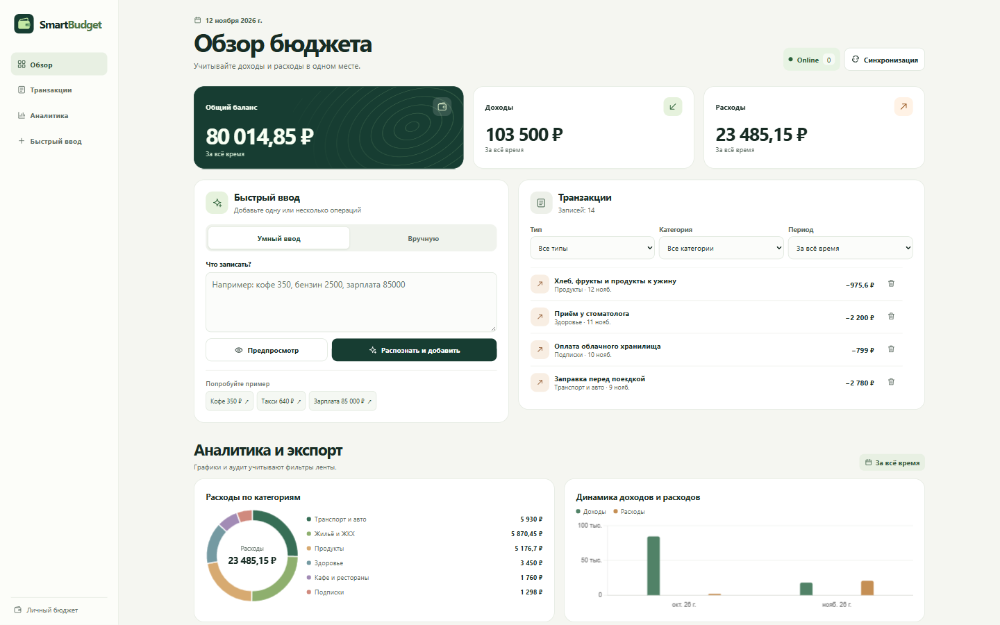
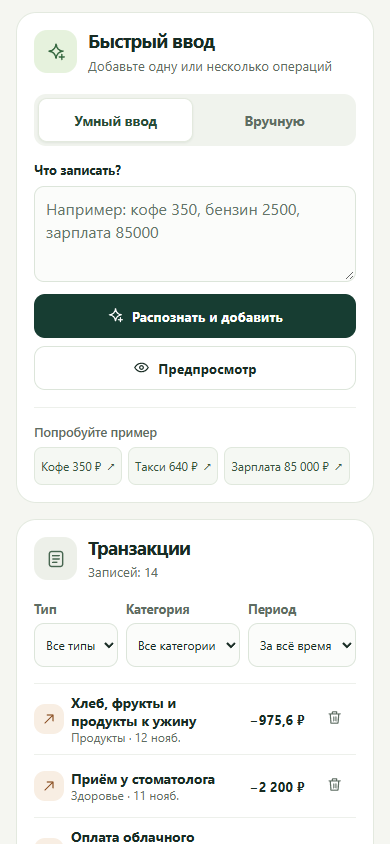
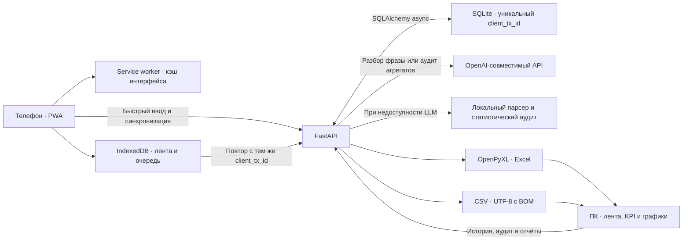

# SmartBudget PWA

SmartBudget — приложение для личных финансов. Фиксируйте расходы на телефоне сразу после покупки, а на ПК анализируйте бюджет и выгружайте отчёты.

[Техническое задание](docs/TZ.md) · [Бизнес-кейс](docs/BUSINESS_CASE.md)

[Репозиторий на GitHub](https://github.com/alex-hash986/PersonBuhYchet)

## Возможности

- **AI Quick Add** разбирает русскоязычную фразу в несколько операций. Результат можно проверить перед сохранением. При недоступности OpenAI работает локальный разбор.
- **Offline-First PWA** сохраняет ленту и очередь в IndexedDB. Интерфейс доступен офлайн после первого открытия, а изменения отправляются после восстановления связи.
- **Desktop Analytics и AI-аудит** показывают KPI, структуру расходов, динамику доходов и расходов и короткий аудит бюджета. Графики учитывают локальные записи, ожидающие синхронизации.
- **Excel и CSV** выгружают подтверждённые операции по фильтрам ленты. Excel содержит три листа, CSV использует UTF-8 с BOM.
- **Демо в один клик.** В разделе «Аналитика и экспорт» нажмите «Загрузить демо-данные». Появятся 14 операций за 14 дней. Уже существующие демо-записи при повторном нажатии пропускаются.

## Интерфейс

**Десктопный аналитический кабинет**



**Мобильный PWA-интерфейс**



## Архитектура



Стек проекта: Python 3.12, FastAPI, SQLAlchemy async, SQLite, Vanilla JS, IndexedDB, Tailwind CSS и Chart.js.

## Быстрый запуск

### Docker Compose

```powershell
if (-not (Test-Path .env)) { Copy-Item .env.example .env }
docker compose up --build
```

Откройте [SmartBudget](http://127.0.0.1:8000/) или [Swagger UI](http://127.0.0.1:8000/docs). Compose хранит SQLite в именованном томе и публикует порт на loopback. Пустой ключ OpenAI подходит для демо: приложение использует локальные алгоритмы.

### Локально с Python 3.12

```powershell
python -m venv .venv
.\.venv\Scripts\python.exe -m pip install -r requirements.txt
if (-not (Test-Path .env)) { Copy-Item .env.example .env }
.\.venv\Scripts\python.exe -m uvicorn app.main:app --reload
```

Таблицы создаются при старте. Чтобы установить PWA, сначала откройте приложение при доступном сервере и воспользуйтесь кнопкой установки или меню браузера. Для доступа с телефона нужен HTTPS. Локально на компьютере подходят `localhost` и `127.0.0.1`. API рассчитан на локальную демонстрацию и доступен без аутентификации.

### Настройки `.env`

| Переменная | По умолчанию | Назначение |
| --- | --- | --- |
| `DATABASE_URL` | `sqlite+aiosqlite:///./smartbudget.db` | Локальная SQLite. Compose задаёт путь `/data/smartbudget.db` внутри тома. |
| `OPENAI_API_KEY` | Пусто | Ключ для разбора и аудита через модель. При пустом значении используются локальные алгоритмы. |
| `OPENAI_BASE_URL` | `https://api.openai.com/v1` | Адрес OpenAI или совместимого прокси. |
| `OPENAI_MODEL` | `gpt-4o-mini` | Модель с поддержкой Structured Outputs. |
| `CORS_ORIGINS` | `["http://localhost:5173","http://127.0.0.1:5173"]` | JSON-массив разрешённых источников при запуске отдельного фронтенда. |

## API

| Метод и путь | Назначение |
| --- | --- |
| `GET /api/health` | Проверка API и доступности БД. |
| `GET /api/transactions` | Лента. Фильтры `date_from`, `date_to` и `type`. |
| `POST /api/transactions` | Создание одной операции. При повторном `client_tx_id` возвращает `409`. |
| `POST /api/transactions/parse` | Предпросмотр по телу `{"text":"кофе 350"}` без записи в БД. |
| `POST /api/transactions/quick-add` | Разбор и сохранение по `text` и `client_tx_id_prefix`. |
| `POST /api/transactions/sync` | Синхронизация массива `transactions`. Возвращает `created` и `skipped_client_tx_ids`. |
| `POST /api/transactions/seed-demo` | Демо-заполнение без тела запроса. Возвращает созданные записи и пропущенные идентификаторы. |
| `DELETE /api/transactions/{transaction_id}` | Удаление операции по серверному ID. |
| `POST /api/analytics/insights` | Аудит по `transactions` или `filters`. Возвращает `observations` и `parsed_by`. |
| `GET /api/export/excel` | Скачивание `smartbudget_report.xlsx`. |
| `GET /api/export/csv` | Скачивание `smartbudget_report.csv`. |

`date_from` и `date_to` принимают календарные даты в UTC включительно. Экспорт также поддерживает `category` и `start_at` с часовым поясом, чтобы выгрузка из интерфейса учитывала границу периода устройства. В файлах даты и месяцы указаны в UTC, расходы в листе «Операции» и CSV записаны со знаком минус.

## Тесты

```powershell
.\.venv\Scripts\python.exe -m pip install -r requirements-dev.txt
.\.venv\Scripts\python.exe -m pytest -q
```

Тесты используют SQLite в памяти и мок HTTP-транспорта OpenAI. Они проверяют разбор, синхронизацию, форматы выгрузок, аудит и повторное демо-заполнение.

## Структура проекта

```text
app/
├── main.py
├── routers/
├── services/
└── static/
docs/
├── TZ.md
├── BUSINESS_CASE.md
└── screenshots/
    ├── desktop_dashboard.png
    └── mobile_pwa.png
tests/
```
